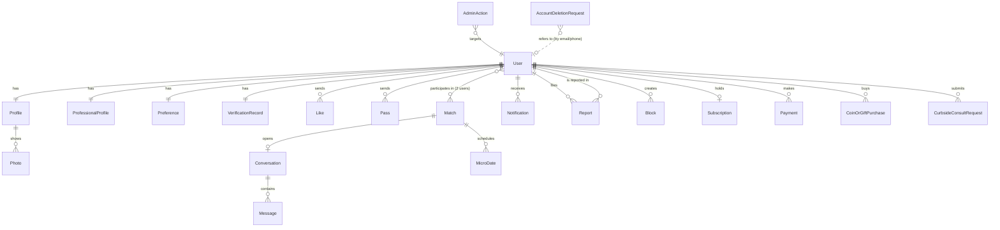

# KodeCupid — Data Model

All entities live in `src/types/index.ts`. In the prototype they're stored in a single JSON snapshot (`Db`) in `localStorage`; in production each maps to a table / collection. IDs are strings (use UUIDs); timestamps are ISO-8601.

## Relationships

`MemberRecord` (`User + Profile + ProfessionalProfile + Preference + VerificationRecord`) is the joined view the UI works with; production code would expose it as a SQL view or API response.

## Entities

### Identity & profile
| Entity | Key fields |
| --- | --- |
| **User** | `id`, `phone`, `email?`, `displayName`, `role` (member/moderator/admin), `accountStatus` (active/suspended/removed/pending_deletion), `plan` (free/silver/premium), `pass?` (daily/hourly + `expiresAt`), `adminNotes`, `lastActiveAt`, `createdAt`, `updatedAt` |
| **Profile** | `userId`, `displayName`, `dateOfBirth`, `age` (derived), `genderIdentity`, `genderCustom?`, `interestedIn`, `location` (`city`, `neighborhood`, mock `lat`/`lng`), `photos[]`, `bio`, `heightCm?`, `bodyType?`, `hairColor?`, `eyeColor?`, `languages[]`, `educationLevel?`, `credentials[]` (MD, RN, PhD…), `religion?`, `ethnicity?`, `politicalViews?`, `lifestyle` (drinking, smoking, cannabis, exercise), `interests[]`, `icebreakers[]`, **`privacy`** (visibility toggles), **`workplacePrivacy`** (`enabled`, `radiusMiles`=1, `hiddenFacilityIds[]`), **`notificationPrefs`** (+ **`quietHours`**), timestamps |
| **ProfessionalProfile** | `userId`, `category` (healthcare/education/college/science/other), `jobTitle`, `specialty`, `workplaceName`, `facilityId?`, `workplaceType`, **`schedule`** (days/nights/swings/weekday/variable), `shiftStart`, `shiftEnd` |
| **VerificationRecord** | `userId`, `status` (unverified/pending/needs_info/verified/denied), `method` (npi/manual/demo), `npiNumber?`, `npiLookup?`, `uploadedCredential?` (private), `submittedAt`, `reviewedAt`, `reviewerNote`, `history[]` (audit trail) |
| **Photo** | `id`, `url`, `alt`, `kind` (placeholder/upload) |
| **Preference** | `userId`, `lookingFor[]` (13 relationship goals), `familyPlans?`, `ageMin`, `ageMax`, `maxDistanceMiles`, `preferredProfessions[]` |

### Interactions
| Entity | Key fields |
| --- | --- |
| **Like** | `fromId`, `toId`, `kind` (like/super), `createdAt` |
| **Pass** | `fromId`, `toId`, `createdAt` |
| **Match** | `userIds[2]`, `score` (prototype estimate), `status` (active/expired/unmatched), `createdAt`, `expiresAt` |
| **Conversation** | `matchId?`, `participantIds[2]`, `preMatch` (paid pre-match thread), `expiresAt`, `lastMessageAt` |
| **Message** | `conversationId`, `senderId`, `body`, `imageUrl?`, `createdAt`, `readAt?`, `removedByModerator?` |
| **MicroDate** | `matchId`, `fromId`, `toId`, `date`, `blockIds[]`, `startLabel`, `venueId`, `venueName`, `note?`, `status` (pending/accepted/declined/expired), `respondedAt?` |
| **Notification** | `userId`, `type` (match/message/like/date/verification/billing/safety), `title`, `body`, `link?`, `read`, `held?` (quiet hours), `createdAt` |

### Trust & safety
| Entity | Key fields |
| --- | --- |
| **Report** | `reporterId`, `reportedId`, `targetType` (profile/message), `messageId?`, `category` (7 values), `details`, `evidence[]`, `status` (new/in_review/resolved), `resolution?` |
| **BlockRecord** | `userId`, `blockedId`, `createdAt` |
| **AdminAction** | `adminId`, `targetUserId?`, `targetRef?`, `action`, `note`, `createdAt` — append-only audit log |
| **AccountDeletionRequest** | `contact` (email/phone), `reason`, `status` (new/processing/completed), `notes`, timestamps |

### Commerce & support
| Entity | Key fields |
| --- | --- |
| **Subscription** | `userId`, `plan`, `status` (active/canceled/past_due), `provider` (stripe/square/paypal), `priceCents`, `startedAt`, `renewsAt`, `canceledAt?` |
| **Payment** | `userId`, `kind` (subscription/pass/coins/gift/consult/prematch), `description`, `amountCents`, `provider`, `status` (succeeded/failed/refunded) |
| **CoinOrGiftPurchase** | `userId`, `item`, `coins`, `quantity`, `amountCents` |
| **CurbsideConsultRequest** | `userId`, `question`, `context?`, `screenshotUrl?`, `priceCents` (4500), `status` (submitted/in_review/answered), `respondBy` (+48 h), `response?`, `respondedAt?` |

### Supporting
| Entity | Purpose |
| --- | --- |
| **CmsPage** | Admin-editable placeholder content (`slug`, `title`, `body`) |
| **AppSettings** | Per-user chat/safety settings: `matchExpiryDays`, `videoEnabled`, `contentFilter`, `blurImages`, `filterWords`, `simulatedTime` (demo only) |
| **Wallet** | Per-user `coins`, `preMatchCredits`, `superLikes` |
| **Session** | Prototype auth session: `userId`, `phone`, `onboardingComplete`, `adminEmail` |

## Production mapping notes

- **Indexes:** `likes(from_id,to_id)`, `matches(user_a,user_b)`, `messages(conversation_id,created_at)`, GiST index on `profiles.location` (PostGIS `geography`).
- **RLS:** members read only their own matches/messages; `verification.uploadedCredential` is readable only by moderators; blocked pairs are excluded in discovery queries.
- **Privacy toggles** are enforced by the API when serialising a profile (never by the client).
- **Derived values:** `Profile.age` is computed from `dateOfBirth`; `Match.score` comes from the server ranker.
- **Retention:** deletion requests trigger a pipeline that removes profile rows, photos, messages and documents; keep minimal audit records as required by law.
